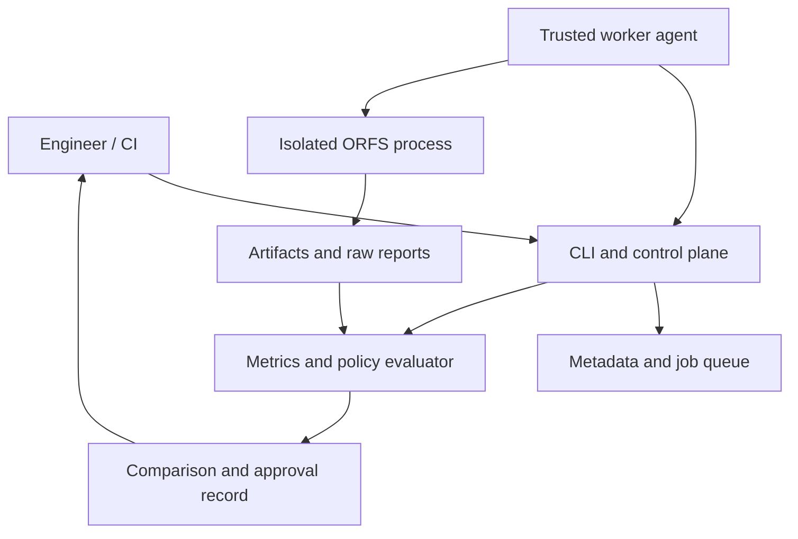
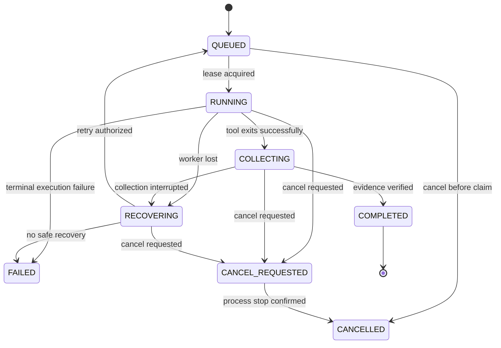

# Project 1: VLSI CAD Execution and Regression Platform

**Document status:** Proposed project specification and implementation plan, expanded on 15 November 2026. No application has been implemented or tested by creating this document.

**Client:** Delta Silicon, a fictional semiconductor-team scenario. Business rules, example measurements, thresholds, and operating targets are proposed lab requirements unless explicitly identified as observed upstream behavior.

**Purpose:** Build practical VLSI CAD flow-engineering skills through real design runs, report interpretation, regression investigation, and the supporting software that makes those activities repeatable.

**Delivery approach:** R1 produces a useful local workflow; R2 adds shared execution and recovery; R3 adds a bounded cloud demonstration. The full project includes all three. This document defines milestones rather than an evening-by-evening schedule.

**How to use this document:** Read sections 1–6 for scope and architecture, 7–9 for contracts and execution details, 10–17 for the supporting environment and validation, and 18–20 for implementation and completion. All `cadctl` commands and project API endpoints are proposed interfaces to implement. Exact tool revisions and measured resource limits must be recorded during setup.

**Technical basis:** Upstream documentation was consulted on 15 November 2026. Source references [S1]–[S9] appear beside relevant external facts and are linked at the end. Architecture choices and lab acceptance policies are this project's design, not claims that the upstream tools provide the whole platform.

### Navigation

- [1. Project Definition and Scope](#1-project-definition-and-scope)
- [2. Complete Client Requirements](#2-complete-client-requirements)
- [3. CAD Flow Concepts and Input Contracts](#3-cad-flow-concepts-and-input-contracts)
- [4. Separation of Concerns and Ownership](#4-separation-of-concerns-and-ownership)
- [5. High-Level Design — System Architecture](#5-high-level-design--system-architecture)
- [6. High-Level Design — End-to-End Flows](#6-high-level-design--end-to-end-flows)
- [7. Low-Level Design — Repository, Domain, and Data](#7-low-level-design--repository-domain-and-data)
- [8. Low-Level Design — Execution and Scheduling](#8-low-level-design--execution-and-scheduling)
- [9. Low-Level Design — Metrics and Regression Decisions](#9-low-level-design--metrics-and-regression-decisions)
- [10. Supporting Development Environment](#10-supporting-development-environment)
- [11. Compute and Deployment Environment](#11-compute-and-deployment-environment)
- [12. Regression Investigation and Release Decisions](#12-regression-investigation-and-release-decisions)
- [13. Security and Access Control](#13-security-and-access-control)
- [14. Reliability and Recovery](#14-reliability-and-recovery)
- [15. Observability and Operations](#15-observability-and-operations)
- [16. Testing and Validation](#16-testing-and-validation)
- [17. Delivery, Upgrades, and Change Management](#17-delivery-upgrades-and-change-management)
- [18. Ordered Implementation Milestones](#18-ordered-implementation-milestones)
- [19. Milestone Planning and Risk Management](#19-milestone-planning-and-risk-management)
- [20. Final Deliverables, Acceptance, and Handover](#20-final-deliverables-acceptance-and-handover)


## 1. Project Definition and Scope

### 1.1 Problem Statement and Business Objectives

Build a platform that lets a chip-design team submit a design, execute an approved physical-design flow, retain the evidence, and compare the result with an approved reference. The business problem is that a successful tool exit does not prove that a design still meets its requirements. The platform must distinguish execution success, trustworthy measurement, and design acceptance.

The learning objective is CAD flow engineering: understand enough of the design and reports to diagnose a regression, then automate the repeatable work around that investigation.

### 1.2 Semiconductor Client and Operating Context

Use a fictional client, Delta Silicon, with two design teams sharing limited Linux compute. Its engineers maintain several small digital blocks and periodically change RTL, constraints, and EDA tool versions. The client needs consistent execution and review before accepting those changes.

This is a proposed lab brief, not a claim about an actual company's practices. All numerical limits below are initial lab policies to validate, not measured performance or industry standards.

### 1.3 Stakeholders, Design Teams, CAD Engineers, and Operators

| Role | Decision or responsibility |
|---|---|
| Design engineer | Own RTL, constraints, and interpretation of affected paths |
| CAD engineer | Own flow integration, reproducibility, and report adapters |
| Platform operator | Own worker health, storage, deployment, and recovery |
| Baseline approver | Review evidence and authorize a reference change |
| Project administrator | Manage project access and quotas |

One learner can exercise every role using separate test identities. Separate identities demonstrate authorization behavior; they do not create real organizational independence.

### 1.4 Current Workflow and Pain Points

The starting workflow is a collection of manual commands and copied output directories. Engineers cannot reliably answer which configuration produced a report, whether a run used the same technology files, or whether a failed job left apparently valid output. Old results may be overwritten, and a new tool version may be accepted after testing only one block.

Capture these failures as test scenarios before building the platform.

### 1.5 Target Workflow and Expected Business Value

An engineer registers an immutable input revision and submits a run. The platform validates it, schedules execution, captures logs and artifacts, verifies completeness, normalizes metrics, and evaluates a recorded policy against a recorded baseline. The engineer reviews the timing and physical evidence. An authorized approver may then promote a new baseline.

The intended value is less repeated setup and investigation effort, while keeping design decisions visible and reviewable.

### 1.6 In-Scope Capabilities

Deliver three cumulative releases:

| Release | Scope | Completion boundary |
|---|---|---|
| R1: local CAD workflow | One trusted user, one worker, real ORFS flow, immutable runs, comparison report | Sections 18.1–18.7 |
| R2: shared lab platform | Multiple blocks, queueing, recovery, project access, audit, operations | Sections 18.8–18.11 |
| R3: cloud execution | Reproducible cloud worker, cost controls, full demonstration | Sections 18.12–18.14 |

The complete project includes all three. R1 is independently useful and should be completed before expanding the architecture.

### 1.7 Out-of-Scope Capabilities

Do not build a synthesis, placement, routing, or static timing analysis engine. Do not design a processor from scratch, implement a foundry qualification program, or promise fabrication readiness. Initially exclude GPUs, Kubernetes, commercial license servers, automatic design optimization, and a rich web frontend.

These exclusions protect the core goal: running and investigating a real CAD flow. A feature enters scope only when a concrete acceptance scenario requires it.

### 1.8 Open-Source Lab Scope and Commercial Environment Boundaries

Use public example designs and a supported open platform for the lab. Start with the ORFS gcd/nangate45 example; the official installation verification uses this small flow. [S1]

Commercial environments may add proprietary PDK access, EDA licenses, license-token scheduling, restricted networks, and approved sign-off tools. Model those as future interfaces, not simulated proof that this lab meets commercial tapeout requirements.

### 1.9 Minimum Complete Deliverable

R1 must produce a real baseline run, a controlled candidate run, and a report identifying inputs, configuration, versions, execution status, metric validity, differences, and acceptance verdict. It must also demonstrate a failed run that cannot pass validation.

A fresh work directory must reproduce the experiment using documented commands. Installing tools or collecting screenshots alone does not satisfy this deliverable.

### 1.10 Assumptions, Dependencies, and Open Questions

Assume a Windows laptop with a usable Linux environment, internet for installation, and AWS access if needed. Recheck available RAM, disk, virtualization, and Docker before execution; historical hardware information is not a current measurement.

Unresolved implementation decisions are the exact tested ORFS revision/image digest, second block, measured resource limits, cloud region, spending ceiling, and identity provider. Resolve each at the milestone where it matters; none prevents this design document from being complete.

### 1.11 Future Extensions

After R3, consider license-aware scheduling, an existing batch scheduler adapter, additional platforms/corners, richer path analysis, or parameter sweeps. Each extension needs a requirement, an owner, and an acceptance test. Add a web UI only if the CLI and reports make a demonstrated review workflow unnecessarily difficult.


## 2. Complete Client Requirements

### 2.1 Business Requirements and User Journeys

The client needs repeatable evidence for design changes and tool upgrades. Primary journeys are submitting a run, examining a failure, comparing a candidate, approving a baseline, cancelling work, and recovering from worker loss. Secondary journeys are onboarding a block and auditing a decision.

A developer should provide design-specific inputs and policy. The platform should supply execution, evidence capture, and recovery without requiring a new orchestration script for every block.

### 2.2 Design Blocks and Supported Flow Variants

Support a block identified by project, name, top module, source revision, and technology platform. A variant identifies an approved constraint/configuration profile. R1 executes a full flow; R2 may add synthesis-only checks, explicitly labeled as partial scope.

Begin with one block, then add a second small public block that exists in the pinned ORFS checkout. Do not assume an arbitrary design supports every platform.

### 2.3 Per-Block Timing, Area, and Design-Rule Requirements

For the initial acceptance profile, require complete final-stage measurements, nonnegative reported setup and hold worst slack for the required checks, and zero counted routing violations in the selected report. These checks are limited to their stated analysis scope.

Use an illustrative 5% area-growth review limit against the approved baseline. Establish the actual absolute area budget and clock target from a measured baseline. Record required clocks, corners, path groups, and permitted timing exceptions so missing coverage cannot look like success.

### 2.4 Approved Tool and Technology Versions

Create an approved-tool registry containing the ORFS commit, container digest or build identity, OpenROAD and Yosys versions, adapter version, and platform-file hashes. Every submitted run resolves to an immutable entry.

Mutable tags such as latest may be used to discover a candidate installation, but never as the sole identity of an accepted run. Upgrades create new entries and comparison evidence.

### 2.5 Project Deadlines and Job Priorities

Use normal and urgent job classes in R2. Only an authorized role can request urgent service. Priority affects waiting jobs; do not preempt a running CAD process in the initial scheduler.

A requested deadline is advisory unless capacity analysis proves it can be met. The platform must explain queue delay and reject impossible resource requests rather than silently promise completion.

### 2.6 Shared Compute Limits, Team Quotas, and Fairness

R1 runs one job with an explicit thread limit. R2 gives each project a concurrent-job cap and considers CPU, memory, and available scratch storage before admission. Start with one running job per project and a queue limit of ten pending jobs per project; these are configurable lab defaults.

Aging and round-robin selection prevent repeated urgent submissions from permanently starving normal work.

### 2.7 Run Reproducibility and Evidence Retention

Preserve the resolved input bundle, effective configuration, tool identity, command arguments, relevant environment, raw reports, normalized metrics, and comparison policy. Store hashes and capture timestamps.

Reproducibility means reconstructing the same experiment and obtaining results within stated tolerances. Bit-for-bit identical output is a stronger claim and must not be assumed across different machines or multithreaded runs.

### 2.8 Baseline Approval, Exceptions, and Waiver Policies

Only complete, valid, eligible runs can become baselines. A performance or area exception requires a named rule, explanation, approver, affected comparison, and expiry. Missing evidence, unauthorized execution, and corrupt artifacts cannot be waived into acceptance.

Promotion adds a new baseline record and preserves the prior reference. Historical reports retain the baseline and policy they originally used.

### 2.9 Design Confidentiality and Project Isolation

Restrict submission, report viewing, artifact download, cancellation, and promotion by project. Apply checks to artifact access as well as run metadata. R1 is a trusted single-user lab; R2 adds application-level project isolation.

Do not claim hostile multi-tenant execution security from ordinary containers. Restrict submitted designs/scripts to reviewed sources; stronger untrusted execution would require a separate threat model and stronger isolation.

### 2.10 Integration and Reporting Requirements

Expose a CLI and machine-readable JSON first, with a human-readable Markdown comparison report. Add an HTTP control API in R2 for remote workers and users. Provide documented import/export formats rather than forcing the client to query internal tables.

A CI job must receive distinct signals for accepted, rejected, and inconclusive work. It must never treat an unavailable comparison service or missing report as a pass.

### 2.11 Performance, Capacity, and Availability Requirements

Target the following in a controlled lab: a durable run ID returned within two seconds at the 95th percentile for 20 small submissions, and a normalized comparison within ten seconds when both metric sets are already stored. Exclude source upload and CAD runtime from these targets.

Measure real flow runtime and memory before setting execution expectations. The laptop service is available while deliberately running; it has no 24/7 uptime commitment.

### 2.12 Recovery and Operational Support Requirements

After a coordinator restart, accepted jobs must still be listed and reconciled. After worker loss, the attempt becomes unknown or lost, never successful without verified evidence. Start with a 10-second heartbeat, a 60-second lease, and a 30-second reconciliation interval in R2; validate these under load.

Preserve enough evidence for an operator to identify the last confirmed stage and choose retry or investigation.

### 2.13 Deployment, Connectivity, and Licensing Constraints

Use a supported Linux execution environment and public assets for the initial lab. Record licenses and permitted redistribution for tool images, example RTL, and technology files. Do not upload proprietary files to external services without project authorization.

Internet access is useful for provisioning but should not be required by a CAD job after its inputs are staged. Air-gapped deployment is a future packaging requirement, not a mandatory first-release task.

### 2.14 Laptop, Cloud, and Budget Constraints

Start with one job and two tool threads. Allocate memory only after inspecting current host availability; an initial 6 GiB job limit is an experiment, not a guarantee that a selected design fits. Preserve headroom for Windows, Linux, and the coordinator.

Cloud execution stays disabled until a region and explicit spending ceiling are chosen. This document does not authorize provisioning or spending.

### 2.15 Requirement Priorities and Dependencies

P0 is real flow execution, provenance, complete evidence, trustworthy comparison, and failure visibility. P1 is multi-block scheduling, recovery, project authorization, and operational tooling. P2 is cloud workers and broader release automation.

The dependency order is real CAD evidence first, automation second, distributed execution third. Do not build a scheduling platform before a known-good flow exists.

### 2.16 Measurable Acceptance Criteria

| ID | Acceptance evidence |
|---|---|
| AC01 | Fresh workspace reproduces a recorded baseline within documented tolerances |
| AC02 | Controlled timing/configuration change is visible and correctly classified |
| AC03 | Missing required metrics and failed runs cannot receive PASS |
| AC04 | Concurrent duplicate submission returns one logical run |
| AC05 | Worker loss cannot allow a stale attempt to finalize the run |
| AC06 | A user from another project cannot read artifacts or promote a baseline |
| AC07 | Two blocks are evaluated independently; one regression fails the required suite |
| AC08 | Backup restoration recovers metadata and resolves artifact references |
| AC09 | Cloud execution records equivalent inputs and obeys session limits |
| AC10 | Historical approvals and baseline changes remain auditable |

### 2.17 Requirements-to-Design-and-Test Traceability

| Requirement | Design sections | Validation | Release |
|---|---|---|---|
| Reproducible execution | 7.3–7.5, 10.5 | AC01; 16.4, 16.13 | R1 |
| Correct comparison | 9, 12 | AC02, AC03; 16.11–16.12 | R1 |
| Duplicate-safe submission | 7.11, 8.10 | AC04; 16.7 | R2 |
| Recovery and fencing | 8.6, 8.11, 14 | AC05; 16.8 | R2 |
| Project isolation | 13 | AC06; 16.15 | R2 |
| Multi-block release gate | 9.7, 17.8 | AC07; 16.16 | R2 |
| Restore and audit | 14.11–14.12, 15.10 | AC08, AC10 | R2 |
| Cloud portability and limits | 11 | AC09; 16.13 | R3 |


## 3. CAD Flow Concepts and Input Contracts

### 3.1 RTL Sources and Design Hierarchy

RTL describes digital behavior and structure, usually in Verilog/SystemVerilog. The top module is the entry point of the design hierarchy. Identify its ports, clock, reset, and registers before running the tools.

For the supplied gcd example, explain the block's purpose and identify at least one register-to-register path. You need enough design understanding to interpret reports; writing a new hardware design is not required.

### 3.2 Timing Constraints and Clock Definitions

An SDC constraint file describes timing intent such as clocks, input/output delays, and selected timing exceptions. A clock period is the allowed cycle duration; reducing it asks for faster operation. Setup slack expresses timing margin for a setup check, and negative slack indicates that check is violated.

Hold checks are separate. A positive setup result alone is insufficient. Missing clocks or unjustified false paths can hide problems, so record and review constraint coverage.

### 3.3 Technology Files and Platform Configuration

Technology inputs describe available cells, geometry, timing behavior, and interconnect assumptions. Examples include Liberty timing libraries, LEF physical descriptions, and extraction rules. The platform bundles must be versioned with their configuration.

Keep the first experiments on one platform. Results from different technologies or timing corners are not automatically comparable.

### 3.4 Synthesis, Floorplanning, Placement, and Routing

| Flow stage | Main question |
|---|---|
| Synthesis | How is RTL mapped into logic cells? |
| Floorplanning | Where are the core, ports, and major physical regions? |
| Placement | Where are cells positioned? |
| Clock-tree synthesis | How is the clock distributed? |
| Routing | How are signal connections physically formed? |
| Final reporting | What timing and physical results does this flow produce? |

Use the existing ORFS stages and inspect their outputs rather than reimplementing them. [S2]

### 3.5 Timing Analysis and Physical Verification Boundaries

Static timing analysis evaluates timing paths under specified constraints and models. Physical checks examine selected layout rules. Capture which tool, stage, corner, and rule scope produced each result.

Routing violation counts are not a substitute for complete foundry DRC/LVS sign-off. A completed RTL-to-layout flow also does not establish logical equivalence to the original RTL; that is a distinct verification responsibility.

### 3.6 Intermediate Artifacts and Stage Dependencies

Each stage consumes specific files and produces artifacts such as mapped netlists, design databases, reports, or layout output. Model these dependencies explicitly. A file's existence is insufficient: verify that it belongs to the current attempt and passes the expected integrity checks.

Preserve the native ORFS directory structure inside each workspace, then index its outputs externally.

### 3.7 Design Input Validation

Before accepting work, verify the top module, source files, platform identity, required constraints, configuration schema, and permitted paths. Reject missing inputs, unresolved placeholders, invalid resource values, and sources outside the approved bundle.

Preflight catches configuration errors; it cannot prove the RTL is correct or that the flow will meet timing.

### 3.8 Tool-Specific Configuration and Tcl Entry Points

Keep ORFS integration behind an adapter that owns supported targets, configuration variables, Tcl hooks, and output discovery. ORFS configuration uses makefiles and documented variables; precedence must be understood and effective values recorded. [S3]

Treat makefiles and Tcl scripts as executable code. The API accepts approved settings, not unrestricted shell fragments.

### 3.9 Learning-Platform Results and Production Sign-Off Boundaries

The project demonstrates CAD automation, reproducible experiments, and regression investigation on public designs. Its acceptance statement must name the exact timing and physical checks performed.

Do not describe the output as tapeout-ready silicon. Production sign-off would require the relevant foundry rules, approved toolchain, verification coverage, and engineering review outside this lab's scope.


## 4. Separation of Concerns and Ownership

### 4.1 Hardware Design and Constraint Ownership

The design role owns RTL intent, clock targets, legitimate timing exceptions, and whether a physical change is acceptable. The CAD platform may report a violation but must not silently relax a clock or add a false path to make the report green.

### 4.2 CAD Flow Automation Ownership

The CAD role owns the ORFS adapter, stage mapping, reproducible tool environment, and diagnostic procedure. It decides how a supported design is executed and how evidence is extracted, while preserving the design team's declared requirements.

### 4.3 EDA Tool Execution Boundaries

EDA tools perform synthesis and physical-design computation. The platform invokes them, captures results, and classifies failures. Tool output is evidence to validate, not an instruction that may change platform policy or execute arbitrary control-plane actions.

### 4.4 Compute Scheduling and Infrastructure Responsibilities

The scheduler owns admission, quotas, leases, and resource reservations. The worker owns local process execution and cleanup. Infrastructure owns machines, disks, networking, and images. None of these components decides whether a timing regression is acceptable.

### 4.5 Metrics Extraction and Normalization

Adapters convert version-specific outputs into a documented metric schema. They retain source location, units, analysis context, and validity. They do not approve changes or replace missing values with convenient defaults.

### 4.6 Regression Evaluation and Policy Ownership

The evaluator applies a versioned policy to validated metrics and an eligible baseline. It produces findings with limits and evidence. The policy owner sets thresholds; the evaluator does not invent thresholds from the candidate it is judging.

### 4.7 Baseline Approval and Human Decision Responsibilities

A baseline approver accepts or rejects a documented change. The platform enforces permissions, eligibility, and audit recording. A learner acting as both author and reviewer must label that as a role simulation rather than independent review.

### 4.8 Artifact Storage, Retention, and Access Ownership

The storage layer verifies artifact identity and retains referenced evidence. Project owners set retention within platform limits. Automatic cleanup must never delete a baseline, active investigation, or required input bundle merely because its age exceeds the normal scratch policy.

### 4.9 Interface Contracts and Explicit Component Exclusions

Use explicit contracts between submission, scheduling, execution, parsing, evaluation, and storage. A worker cannot edit policies; a parser cannot promote baselines; a report renderer cannot mutate run state. Shared domain types live in one package, but each module exposes a narrow interface.

### 4.10 Configuration and Secret Ownership

Project configuration owns design settings; operators own resource limits and storage endpoints. Secrets are supplied by the runtime and referenced by name, never embedded in run manifests. Effective nonsecret configuration is captured so a report can be reconstructed.

### 4.11 Failure Handling and Recovery Ownership

Workers stop local processes; the coordinator determines logical run state; the reconciler repairs uncertain control state; an operator handles unresolved incidents. Every failure code identifies the owning layer and a next diagnostic action.


## 5. High-Level Design — System Architecture

### 5.1 System Context and External Actors

Design engineers and CI clients submit work to the control plane. Trusted worker agents execute approved jobs. Operators manage resources and reviewers approve references. External dependencies are the ORFS toolchain, source/artifact storage, and optionally cloud compute and an identity provider.

### 5.2 Major Components and Interaction Diagram



These are logical responsibilities, not a requirement for seven independently deployed services. R1 uses one Python application and one worker process.

### 5.3 Design Submission Interface

R1 offers a CLI with validation before submission. R2 adds an authenticated API using the same application services. Both resolve inputs to an immutable bundle, apply authorization, and return a persistent run ID. Neither holds an HTTP request open for a full CAD run.

### 5.4 Design and Configuration Registry

The registry records approved blocks, platform bundles, tool bundles, and policy versions. Refer to immutable hashes and revision IDs. Registering a new version never changes the inputs of a queued or historical run.

### 5.5 Flow Orchestrator

The orchestrator manages run state and the dependency graph. In R1 it can invoke the full ORFS flow as one supervised job while collecting stage evidence. Later, explicit stage execution adds checkpoint handling. Do not claim arbitrary stage resume until that adapter capability is tested.

### 5.6 Job Scheduler and Worker Pool

Use PostgreSQL as a durable queue in R2, with short transactions for job claims and resource reservations. Workers request jobs matching their capabilities. Row locking with SKIP LOCKED is suitable for queue-like access; it is not a general consistency shortcut. [S7]

A separate message broker is unnecessary for this initial workload.

### 5.7 Isolated EDA Execution Environments

Each attempt gets a fresh workspace, pinned tool image, resource limits, and read-only staged inputs where possible. The trusted host worker launches a restricted job container and collects its outputs. The job container receives neither database credentials nor the host container-runtime socket.

### 5.8 Artifact and Metadata Stores

PostgreSQL stores relationships, lifecycle state, policies, and approvals. A local filesystem adapter stores artifacts in R1/R2; an S3 adapter is added for R3. Store large design files outside the database, with verified references and checksums inside it.

Uploads and database commits are separate operations; section 7.11 defines how publication remains recoverable.

### 5.9 Metrics Collection and Comparison Service

The collection module validates raw outputs and produces normalized measurements. The evaluator compares eligible measurements under an explicit policy. Implement both as modules first. Persistent evaluation records allow reports to be regenerated without rerunning physical design.

### 5.10 Baseline and Approval Service

Store immutable baseline records keyed to a block and comparison profile. Promotion updates the active reference using a version check and records the actor, reason, old reference, and new reference. The application rejects stale concurrent promotion requests.

### 5.11 CLI and Reporting Interface

Provide CLI status, inspection, comparison, cancellation, and baseline commands. Emit a concise Markdown report plus JSON for automation. Link to exact raw evidence using authorized artifact references. A web interface is an optional later presentation layer.

### 5.12 Synchronous and Asynchronous Communication

Validation and status reads are synchronous. Execution, report collection, and recovery are background work. Workers use short polling and heartbeat calls; users poll status initially. Server-sent events or streaming dashboards are optional, not prerequisites for correctness.

### 5.13 Trust Boundaries and Network Architecture

Keep the database and worker management endpoints private. Only the authenticated control interface is reachable by clients. Job execution is a separate trust boundary from the trusted worker agent. Deny design-job network access after staging unless a documented flow needs it.

### 5.14 Scaling Boundaries, Bottlenecks, and Failure Domains

Initial limits are likely worker memory, disk bandwidth, and CAD runtime. Scale by adding eligible workers only after measuring those limits. A failed worker should affect its own attempts; a database outage pauses claims and state changes. The single control-plane host remains an acknowledged availability limitation.

### 5.15 Architecture Alternatives and Decision Records

| Decision | Selected approach | Reason / reconsideration trigger |
|---|---|---|
| Application structure | Python modular monolith | Easier debugging; split only with measured need |
| Execution engine | Existing ORFS | Keeps work on CAD integration |
| Durable coordination | PostgreSQL queue | One transactional source for jobs and state |
| Local deployment | Linux and containers | Reproducible tool environment |
| User interface | CLI, JSON, Markdown | Supports automation without frontend scope |
| Shared artifacts | Filesystem, then S3 | Add remote storage when remote workers exist |
| Cluster orchestration | None initially | Reconsider after multi-host operational evidence |

Record alternatives and consequences in ADRs rather than silently changing these choices.


## 6. High-Level Design — End-to-End Flows

### 6.1 Design Registration and Configuration Validation

The engineer supplies a registered block, source revision, variant, and tool bundle. Resolve and hash the inputs, validate the configuration, check access, and create the immutable run manifest. Reject invalid submissions before queue insertion; record the rejection reason for the user.

### 6.2 Run Submission, Admission, and Scheduling

Create the run and its initial queue entry in one transaction. Return the run ID after commit. The scheduler selects a resource-compatible job and reserves capacity atomically. The worker acknowledges its lease, stages inputs, verifies their hashes, and starts a new attempt.

### 6.3 Stage Execution and Progress Reporting

Record the attempt start before launching the tool. Capture stdout/stderr and stage evidence with timestamps. A heartbeat indicates worker communication, not tool progress; maintain both fields. Terminal stage status requires validated outputs and the adapter's completion rule.

### 6.4 Artifact Capture and Metrics Collection

Collect raw files under an attempt-specific prefix, compute checksums, and publish an artifact manifest. Verify required outputs before normalizing metrics. Finalize the artifact inventory and metrics in metadata only after uploads are confirmed. Interrupted collection stays recoverable, not complete.

### 6.5 Baseline Comparison and Regression Evaluation

Select an explicit baseline and verify the comparison mode. Evaluate required checks, absolute limits, and permitted deltas. Persist a report containing both run IDs, policy digest, measured values, validity, and verdict. A missing baseline yields INCONCLUSIVE, not PASS.

### 6.6 Failure Investigation and Controlled Rerun

An engineer starts with the failure summary, then reads the first failing stage and its raw reports. Correcting inputs creates a new run; retrying unchanged inputs creates a new attempt under the original manifest. Preserve both histories and explain the relationship in the report.

### 6.7 Cancellation and Resource Cleanup

Cancellation sets a durable request flag. The worker terminates the entire job process group/container, collects available diagnostics, and confirms cleanup. A queued job cancels immediately. If an active worker is unreachable, show cancellation pending or attempt lost rather than claiming its process has stopped.

### 6.8 Baseline Approval and Promotion

The reviewer checks completeness, policy eligibility, changed inputs, and design evidence. Promotion uses compare-and-swap against the expected active baseline version. In the same transaction, record the new baseline and audit event. Existing reports continue referring to their original baseline.

### 6.9 Tool Upgrade Validation and Rollback

Run the old and proposed tool bundles against identical approved design inputs and constraints. Evaluate every required block, review differences, and approve the new bundle only after the suite is eligible. Keep the old bundle available for historical reproduction and rollback.

### 6.10 New-Design Onboarding

Add a design descriptor, source bundle, supported platform, constraints, and policy. Run preflight, establish a reproducible baseline, inspect actual timing coverage, and include the block in the suite. Onboarding is complete only when another operator can repeat it using the guide.


## 7. Low-Level Design — Repository, Domain, and Data

### 7.1 Repository and Module Structure

| Path | Responsibility |
|---|---|
| src/cad_platform/domain/ | Entities, lifecycle rules, policy types |
| src/cad_platform/application/ | Submission, evaluation, promotion use cases |
| src/cad_platform/adapters/orfs/ | Commands, stage mapping, output parsers |
| src/cad_platform/storage/ | Metadata and artifact adapters |
| src/cad_platform/worker/ | Leases, supervised execution, cleanup |
| src/cad_platform/interfaces/ | CLI and later HTTP endpoints |
| configs/, policies/ | Reviewed schemas and acceptance policies |
| tests/fixtures/ | Small raw-report fixtures and simulated jobs |
| docs/, infra/ | Runbooks, ADRs, deployment definitions |

These are proposed repository paths; this document does not create the implementation.

### 7.2 Project, Block, Revision, Run, and Stage Models

A project owns blocks. A block has source revisions and variants. A run identifies one immutable experiment. An attempt records one execution of that experiment. Stage records belong to attempts. Evaluations reference a candidate, baseline, and policy.

Keep attempts separate from runs: a retry must not overwrite the failed attempt's logs or obscure which attempt produced the accepted evidence.

### 7.3 Run Manifests and Input Fingerprints

The manifest includes schema version, project/block identity, source bundle hash, top module, platform hashes, constraints hash, resolved configuration, tool identity, adapter version, resource profile, stage scope, and creation actor. Compute the experiment fingerprint from canonical nonsecret inputs.

Exclude mutable lifecycle fields from the fingerprint. Keep a separate comparison signature: tool-upgrade comparisons intentionally permit different tool versions while requiring matching design and analysis context.

### 7.4 Tool, Platform, and Dependency Version Records

Store commit IDs, image digests, executable version output, CPU architecture, operating environment, thread count, and any exposed seed. A source build also records compiler/build identity. Pin the adapter that interpreted reports.

A tool's display version alone may not uniquely identify patched binaries, so retain a binary/image or build hash.

### 7.5 Configuration Schema, Inheritance, and Validation

Use a validated JSON or YAML project descriptor with a schema version and unknown-key rejection. Resolve project defaults, variant overrides, and permitted run overrides before queueing. Never infer the final value solely from the input file if makefiles can override it.

Example schema shape, not ready-to-run configuration:

```yaml
schema_version: 1
block: gcd
platform: nangate45
design_config: designs/nangate45/gcd/config.mk
tool_bundle: REQUIRED_APPROVED_TOOL_ID
source_bundle: REQUIRED_SOURCE_HASH
policy: REQUIRED_POLICY_VERSION
resources:
  threads: 2
  memory_limit_mib: 6144
stage_scope: full
```

Resolve required identities and verify observed settings during onboarding. The memory number is a starting experiment.

### 7.6 Identifiers, Correlation IDs, and Timestamps

Use UUIDs for project, run, attempt, evaluation, and artifact records; human-readable block names are labels, not global keys. Include run_id and attempt_id in all execution logs. Store timestamps in UTC and use monotonic clocks for local elapsed durations.

Ordering decisions use database state/version fields rather than trusting perfectly synchronized worker clocks.

### 7.7 Metadata Schemas, Indexes, and Access Patterns

| Table | Key data and constraints |
|---|---|
| projects, memberships | Project access and roles |
| blocks, input_bundles, tool_bundles | Immutable registered inputs |
| runs | Manifest hash, state, project-scoped idempotency key |
| attempts | Run ID, unique attempt number, lease token, outcome |
| stages | Attempt ID, stage name, timings, outcome |
| artifacts | Attempt ID, path/key, hash, size, publication state |
| metric_sets | Schema version, context, values, validity |
| policies, evaluations | Immutable rules and recorded findings |
| baselines, approvals | Scope, active version, actor, reason |
| workers, reservations | Capabilities, heartbeats, reserved capacity |
| audit_events | Actor, action, target, before/after references |

Index queued work by eligible state/priority and scope; index attempts by run and artifacts by attempt. Enforce uniqueness for submission keys and baseline versions.

### 7.8 Artifact Naming, Indexing, and Retention Metadata

Use project/run/attempt/stage prefixes and stable logical artifact names. Store size, checksum, media type, producer version, and retention status. Write a final artifact manifest that lists required and optional files.

Reference content by verified IDs, not user-controlled filesystem paths. Prefix organization is for traceability; authorization must still check project ownership.

### 7.9 API, CLI, Command, and Event Contracts

The following CLI/API surface is a proposed contract to implement:

| Operation | CLI shape | R2 API |
|---|---|---|
| Submit | cadctl run submit --manifest FILE | POST /v1/runs |
| Inspect | cadctl run inspect RUN_ID | GET /v1/runs/{id} |
| Cancel | cadctl run cancel RUN_ID | POST /v1/runs/{id}/cancel |
| Compare | cadctl compare CANDIDATE --baseline BASELINE | POST /v1/evaluations |
| Promote | cadctl baseline promote EVALUATION_ID | POST /v1/baselines/promotions |
| Worker claim | Internal agent call | POST /v1/worker/claims |

Submission returns 202 only after durable acceptance. Use Idempotency-Key for submission and an expected baseline version for promotion. These commands are not installed by writing this document.

### 7.10 Validation and Error Contracts

Return an error code, concise message, owning component, retryability, and correlation ID. Distinguish INVALID_INPUT, ACCESS_DENIED, NO_CAPACITY, TOOL_FAILED, METRICS_INVALID, STORAGE_UNAVAILABLE, and STALE_LEASE.

For HTTP, use 400 for invalid input, 403 for denied access, 409 for conflicting idempotency/version requests, and 503 for unavailable dependencies. Do not expose secrets or full internal stack traces in user responses.

### 7.11 Transaction and Consistency Boundaries

Submission, job claim, reservation, cancellation request, and baseline promotion each use short database transactions. Never hold a transaction open during physical design or network upload.

Artifact publication is a recoverable protocol: upload to an immutable attempt prefix, verify checksums, then commit inventory and completion using the active lease token. A crash before commit leaves unreferenced objects for reconciliation; a crash after commit is handled by idempotent acknowledgment. Metadata and object storage do not share an atomic transaction.

### 7.12 Adapter Interfaces and Extension Points

Define interfaces for FlowAdapter, ArtifactStore, MetadataRepository, MetricNormalizer, PolicyEvaluator, and WorkerLauncher. The ORFS adapter exposes preflight, command construction, expected outputs, stage discovery, and parsing. Keep scheduling independent of tool-specific filenames.

Add a new adapter only when there is a real second implementation or a test double that exercises an important failure.


## 8. Low-Level Design — Execution and Scheduling

### 8.1 Flow Dependency Graph and Stage Contracts

Represent supported stages and dependencies as an adapter-owned graph. R1 can supervise one full-flow command and observe stage outputs. R2 may execute approved stage targets separately where the pinned release supports them.

A completed node requires the expected outputs and valid provenance. An execution dependency is not proof that timing is acceptable; evaluation remains separate.

### 8.2 Run and Stage State Machines



Attempt outcomes include SUCCEEDED, TOOL_FAILED, LOST, CANCELLED, and INFRA_FAILED. Evaluation is an independent status: NOT_EVALUATED, PASS, FAIL, INCONCLUSIVE, or ERROR. COMPLETED does not imply PASS; PASS_WITH_WAIVER is a separately labeled approval outcome, never a silent PASS.

### 8.3 Worker Capabilities and Resource Reservations

Workers advertise architecture, available tool bundles, CPU/thread capacity, memory, disk headroom, and project eligibility. Store reservations when claiming jobs. Enforce tool thread count and container resource limits as well as scheduler accounting.

If an advertised worker cannot satisfy the request, leave the job queued with a clear reason rather than launching it and hoping it fits.

### 8.4 Admission Control and Queue Limits

Reject invalid or larger-than-any-approved-worker requests at submission. Apply per-project pending-job caps before accepting more work. Queue valid jobs when capacity is temporarily unavailable.

Check local free disk again before staging because advertised capacity may be stale. Keep a reserve for logs and failure evidence.

### 8.5 Priority, Fairness, and Starvation Prevention

Use project round-robin selection, then priority and age within each project. Age waiting jobs into a higher effective priority within a bounded policy. Preserve submission order for equal-ranked work where possible.

This is a non-preemptive lab scheduler. Measure fairness with simulated short jobs; do not promise deadline guarantees for variable-duration CAD runs.

### 8.6 Job Leases, Heartbeats, and Worker Loss

Each claim assigns an attempt ID, increasing fencing token, and lease expiry. Heartbeat renewal succeeds only for the current attempt/token and noncancelled state. Use database time for lease decisions.

On expiry, the coordinator fences the attempt before authorizing replacement. The worker has a local watchdog that terminates its job before it can continue indefinitely without renewal. A partition can temporarily duplicate computation; the design guarantees one accepted result, not exactly-once execution.

### 8.7 Isolated Work Directories and Process Launch

Create a new workspace for every attempt, verify input hashes, and preserve the ORFS internal tree. Construct command argument arrays without shell concatenation. Set a controlled environment and current directory.

The host worker launches a restricted container with only required mounts. Separate job output paths from immutable input bundles and ensure cleanup cannot escape the attempt directory.

### 8.8 Progress Capture and Exit-Code Interpretation

Capture command start/end, exit code, termination signal, and relevant runtime resource events. Track stage progress using the versioned adapter's supported evidence, not a generic grep of the last log line.

A zero exit code is necessary for execution success but insufficient for evidence completeness. Exit 137 alone does not prove an out-of-memory event; corroborate it with runtime/kernel evidence.

### 8.9 Timeouts, Retries, and Cancellation

Configure stage/run timeouts after baseline measurement. R2 starts with at most one automatic retry for a confirmed transient infrastructure failure. Design errors, timing failures, malformed output, cancellation, and unknown external state are not blindly retried.

Cancellation sends graceful termination, waits a configured grace period, then forces termination if needed. Record whether cleanup was confirmed.

### 8.10 Duplicate Submission and Idempotency

Use a unique project-scoped idempotency key with a canonical request hash. A repeated key with the same hash returns the original run; a changed request under the same key returns a conflict.

An intentionally repeated experiment uses a new key and run ID even if its experiment fingerprint matches. This allows repeatability studies without confusing them with duplicate network requests.

### 8.11 Concurrency Control and Stale Worker Results

Use conditional writes requiring expected state, attempt ID, and fencing token. Once an attempt is fenced, its heartbeat and finalization fail. Stale artifacts may remain in its own prefix but cannot become the run's authoritative result.

Test a worker returning after lease expiry and a replacement completing first. The stale worker must not overwrite progress, metrics, or approvals.

### 8.12 Checkpoint Reuse and Invalidation Rules

R1 reruns the whole flow. R2 allows only adapter-certified restart points. Reuse requires matching upstream inputs, tool/platform identity, relevant effective configuration, stage implementation, and validated checkpoint checksums.

Constraint changes may invalidate synthesis and physical stages; do not assume timing can simply be recomputed on an old layout for an equivalent experiment. Tool upgrades default to clean runs.

### 8.13 Orphaned Process and Temporary File Cleanup

Label processes/containers with run and attempt IDs and reconcile them on worker startup. Terminate only verified orphaned jobs owned by this worker. Quarantine incomplete output before retention cleanup.

Do not free a local resource reservation merely because a database lease expired if the process is still running. Confirm termination or mark the worker unavailable until cleanup succeeds.


## 9. Low-Level Design — Metrics and Regression Decisions

### 9.1 Log and Report Parser Interfaces

Prefer structured reports supplied by the pinned ORFS release; keep bounded text parsers only for missing fields. Each parser has fixtures, a supported version range, and required fields. Raw files remain available for reprocessing.

Current ORFS documentation describes metadata generation and dashboard-based QoR checking and notes removal of older rules/golden-file workflows. Verify the pinned checkout instead of copying obsolete tutorial commands. [S4]

### 9.2 Metrics Schema, Units, and Normalization

Each measurement carries name, numeric value or explicit null, unit, stage, corner, path group, source artifact, parser version, and validity. Normalize time to ns, area to square micrometres, duration to seconds, and memory to MiB only when the source unit is known.

Store original units too. A schema-level example is setup_worst_slack_ns=0.12 with validity=VALID; this is a fabricated example, not a measured gcd result.

### 9.3 Missing, Invalid, and Incomplete Results

Represent missing, malformed, unsupported, and unconstrained values explicitly. Never coerce them to zero. A required missing metric produces INCONCLUSIVE or ERROR depending on whether evidence is absent or invalid.

Unsupported optional metrics may be omitted with a reason. Required-check coverage is evaluated before numeric thresholds.

### 9.4 Baseline Selection and Comparison Eligibility

Require matching block, platform, analysis corner/mode, stage, metric semantics, and declared comparison scope. Define three modes: reproduction with all experiment inputs fixed; tool upgrade with only approved tool differences; and design/configuration experiment with explicitly listed changed inputs.

A different clock target may be educational, but it is not evidence of a tool regression. Baseline promotion must use the approved target profile or explicitly establish a new profile.

### 9.5 Absolute Limits and Relative Change Thresholds

Apply absolute requirements before relative tolerances. For positive baseline area A0, calculate area growth as 100 × (A1−A0)/A0. For signed timing slack, compare an absolute difference in ns; percentage change around zero is misleading.

Example policy values are area growth ≤5% and setup slack degradation no more than 0.05 ns, while both runs must still meet their absolute timing requirements. Validate tolerances against repeated baseline measurements.

### 9.6 Per-Block Acceptance Policies

Keep policies per block/variant and version them independently of results. The policy declares required metrics, stages, analysis contexts, absolute limits, relative limits, and whether waivers are allowed.

A candidate must not supply its own relaxed policy through an unreviewed override. Policy edits require the same review and traceability as baseline changes.

### 9.7 Cross-Block Regression Aggregation

The suite passes only when every required block has an eligible passing evaluation, or the release has an explicitly permitted waiver outcome. Do not average area or timing changes across blocks to hide one failing block.

Display PASS, FAIL, INCONCLUSIVE, ERROR, and waived findings separately, along with the number of required cases actually evaluated.

### 9.8 Approved Waivers and Expiration

A waiver records rule ID, specific candidate/baseline pair, measured violation, business justification, reviewer, and expiration. It is immutable once applied and must be reissued for a new candidate.

Do not waive missing input identity, incomplete metrics, authorization failures, or artifact corruption. Those failures prevent trustworthy evaluation.

### 9.9 Approval Records and Baseline Versioning

Baseline versions reference completed run evidence and approved evaluations. Promotion checks that the active reference has not changed since review. Store old and new reference IDs, actor, reason, and policy version atomically.

Retiring a baseline prevents new automatic selection but preserves historical references and retained artifacts.

### 9.10 Comparison Reports and Evidence Links

Every report includes run identity, changed inputs, execution status, validity, baseline eligibility, per-metric comparisons, verdict, and next investigation step. Link each finding to the raw report and relevant stage.

Example comparison, using invented values:

| Metric | Baseline | Candidate | Rule | Finding |
|---|---:|---:|---|---|
| Setup worst slack | 0.12 ns | −0.03 ns | ≥0 ns | FAIL |
| Cell area | 1000 µm² | 1040 µm² | Growth ≤5% | PASS |
| Required hold check | Available | Missing | Evidence required | INCONCLUSIVE |

The overall result cannot pass even though area is within limits.


## 10. Supporting Development Environment

### 10.1 Laptop Prerequisites and Resource Budget

Inspect available RAM, free disk, CPU, virtualization support, and current workloads. The remembered laptop specification is approximately 16 GB RAM, but usable memory must be measured again. Start with one small job and keep several GiB available for the host.

Preflight should refuse execution when configured disk or memory headroom is unavailable instead of allowing the laptop to become unusable.

### 10.2 Linux, Containers, and Runtime Setup

For Windows, use WSL2 with a supported Linux distribution and container integration, or a Linux VM if that is already stable. Keep working files in the Linux filesystem where practical. ORFS documents WSL and Docker-based workflows. [S5]

Choose one route and record it; learning multiple installation methods is not required to complete this project.

### 10.3 OpenROAD Flow Scripts and Supporting Tools

Use the official ORFS installation/container workflow and capture an exact tested revision and image digest. Run its supplied gcd/nangate45 flow first. Once inside a verified ORFS environment, the documented flow has the shape:

```bash
cd OpenROAD-flow-scripts/flow
make DESIGN_CONFIG=designs/nangate45/gcd/config.mk
```

This is an upstream flow invocation, not a complete host installation script. Confirm paths and commands in the pinned release. [S1]

### 10.4 Python, Bash, and Tcl Development Setup

Use Python for orchestration, parsing, validation, and reporting; Bash for short environment/launch tasks; Tcl for approved tool-level reporting hooks. Read enough Tcl to understand the commands executed by the flow.

Avoid implementing the business state machine in shell scripts. Keep shell wrappers small and pass failures back to the Python application.

### 10.5 Dependency Pinning and Reproducible Builds

Commit Python dependency locks, adapter version, ORFS commit, image digest, platform hashes, and configuration schema. Record licenses and source locations for redistributable bundles. Verify the full tool environment with one smoke flow.

A lockfile without a retained or retrievable tool image/input bundle is insufficient for later reproduction.

### 10.6 Developer Bootstrap and Standard Commands

Define a small project command set: environment preflight, start services, register inputs, run a design, compare results, execute tests, and clean scratch. All commands must have predictable exit codes and help text.

Implement the proposed cadctl interface in section 7.9 rather than documenting commands that do not exist. Until implementation, upstream ORFS commands are the only real execution entry points in this document.

### 10.7 Local Metadata and Artifact Services

Run a single PostgreSQL instance and use local artifact directories initially. The coordinator and worker can be separate processes from the same codebase. Avoid adding Redis, RabbitMQ, or object-storage emulators unless a test or remote topology requires them.

Keep persistent volumes separate from attempt scratch and provide a deliberate reset command for disposable fixtures only.

### 10.8 Representative Designs and Test Fixtures

Create fixtures for a valid design, invalid source, missing constraint, absent report, malformed metric, and controlled timing experiment. Store small report fixtures in the repository and large generated output in artifact storage.

Document the origin and tool version of each fixture. Synthetic fixtures test parser behavior; real runs validate that the integration actually works.

### 10.9 Simulated Workers and Controlled Failure Inputs

Build a test worker that can delay, crash, stop heartbeats, emit partial files, and return stale completion messages. It makes scheduling/recovery tests fast and repeatable without rerunning physical design for every failure.

Retain real ORFS failure tests for integration acceptance so a simulator does not become the only evidence.

### 10.10 Environment Profiles and Secrets Handling

Use local, shared-lab, and cloud profiles with the same domain behavior. Profiles change resource endpoints and limits, not acceptance semantics. Inject secrets through the runtime and redact them from manifests/logs.

Resolve and store all nonsecret defaults at submission so changing an environment variable tomorrow does not change the meaning of a historical run.

### 10.11 Debugging, Formatting, and Static Analysis

Use VS Code in the selected Linux environment, Python formatting/linting, type checks where useful, and pytest for behavior tests. Debug the worker and parser separately from the EDA process. Preserve raw logs even when the summary parser fails.

Pin the chosen development tools during implementation; the document does not assert untested version compatibility.

### 10.12 Contributor Documentation

Provide setup instructions, repository navigation, one successful flow, one failure investigation, and the adapter contract. Explain how to add a report fixture and rerun evaluation without rerunning CAD.

The onboarding test is a fresh workspace completing the documented baseline experiment without undocumented local environment fixes.


## 11. Compute and Deployment Environment

### 11.1 Laptop-Only Deployment

Deploy PostgreSQL, the coordinator, and one worker in the chosen Linux environment. Run one CAD job at a time and retain outputs on persistent local storage. Bind management interfaces to loopback during R1. A laptop shutdown stops service availability; restart must reconcile abandoned work before allowing new claims.

### 11.2 Cloud Worker Deployment

For R3, begin with one temporary Linux EC2 host running the control components and one worker, plus private S3 artifact storage. This avoids exposing a sleeping laptop's database to remote workers. Later, worker-only hosts can join through authenticated control APIs. The cloud control plane remains single-host and is not highly available.

### 11.3 CPU, Memory, Disk, and Storage Sizing

Measure peak resident memory, elapsed time, scratch high-water mark, and thread usage for the baseline. Size cloud CPU/memory from those observations with explicit headroom. No GPU is required for this chosen flow. Keep a sizing record per block/tool/profile; a larger design or tool update invalidates an untested resource estimate.

### 11.4 Infrastructure Provisioning and Worker Bootstrap

Describe hosts, access rules, storage, roles, and expiration tags in version-controlled infrastructure configuration. Bootstrap verifies architecture, disk capacity, tool digest, agent version, and storage access before registering a worker. Test provisioning on a fresh host; record manual fixes in the provisioning definition.

### 11.5 Tool Images and Artifact Distribution

Resolve images by digest and verify staged input hashes. Download inputs before execution and upload results afterward; the EDA process does not need cloud credentials. Bound the worker cache of immutable bundles. Neither mutable tags nor writable shared directories may change a running job's identity.

### 11.6 Network Access and Service Identity

Expose only required authenticated control endpoints over TLS. Keep database access private to the control service. Limit worker permissions to claims and assigned artifact locations. The job container must not inherit instance metadata access or cloud credentials. Test credential expiry during upload.

### 11.7 Persistent Data and Ephemeral Worker Storage

Treat worker scratch as disposable until artifact publication is verified. Metadata and committed artifacts are persistent. Before terminating a healthy worker, drain it, finish publication, and confirm there are no active attempts. Eventual host shutdown does not prove its outputs were uploaded.

### 11.8 Worker Capacity Expansion and Reduction

Scale manually first from measured backlog and saturation. New workers must pass their smoke test. To remove a worker, mark it draining, finish or cancel active jobs, then deregister it. Automatic scaling is optional; idle shutdown and maximum-host limits are required for R3.

### 11.9 Cloud Budget Limits and Cost Attribution

Choose a spending ceiling, maximum worker count, session duration, and retention policy before enabling cloud execution. Start with one worker and a two-hour session timer as a lab default, adjusted to observed run duration. AWS Budget notifications can lag actual consumption; alerts alone are not an execution cutoff. Add admission limits, expiry tags, and verified teardown. Retained storage may keep charging after compute stops. [S8]

### 11.10 Idle Resource Shutdown and Cleanup

Stop new admissions, drain or cancel jobs, confirm evidence upload, and stop or terminate tagged lab hosts according to policy. Inspect the remaining disks, IP allocations, and storage. Preserve retained baselines and document deliberately persistent resources and their ongoing cost.


## 12. Regression Investigation and Release Decisions

### 12.1 Timing Slack and Constraint Coverage

Read actual timing paths: launch/capture registers, clock relationship, arrival time, required time, and slack. Review setup and hold separately and verify intended endpoints are constrained. A stricter clock may expose a failure but need not change placement or cause a predictable result. Explain the observed behavior instead of forcing the experiment to match an expected story.

### 12.2 Area and Utilization Comparisons

Distinguish cell area, core area, and utilization. Compare the same metric at the same stage/platform, then inspect cell count, buffering, and placement effects where evidence supports them. Smaller area is not automatically better when timing or routing becomes unacceptable.

### 12.3 Design-Rule Violation Comparisons

Record the originating checker, report stage, and rule scope. Compare violation categories where available and preserve reports identifying affected objects. Zero counted violations means zero for those checks, not universal physical correctness or foundry sign-off.

### 12.4 Runtime and Memory Comparisons

Compare runtime and peak memory under a recorded resource profile. CPU model, thread count, background load, and storage can confound conclusions. Repeat runs before treating small changes as regressions. Cross-machine results may demonstrate functional portability while remaining unsuitable for performance gating.

### 12.5 First Diverging Flow Stage

Align comparable stages and locate the earliest observed divergence, then inspect affected paths and preceding changes. This narrows an investigation without proving causation. ORFS documents endpoint-slack tracking and different parasitic models across stages; record those models before interpreting slack movement. [S9]

Keep local collection separate from upstream dashboard checks. Do not invoke a target that uploads metrics merely to obtain a local report.

### 12.6 Tool Changes Versus Design and Configuration Changes

Keep RTL, constraints, platform, and resource profile fixed when investigating a tool upgrade. In a configuration experiment, declare the changed field and inspect all other manifest differences. If several dimensions change, label the comparison exploratory and avoid assigning the effect to one cause.

### 12.7 Repeated-Run Variability and Comparison Tolerances

Run the baseline three times initially and retain every result, not just the best one. This is a preliminary repeatability check, not a statistically strong performance study. Set tolerances from observations and engineering intent while preserving absolute timing requirements.

### 12.8 Reproduction of Historical Runs

Reconstruct recorded input/tool bundles in a clean workspace, rerun with archived effective configuration, and verify parser compatibility. Missing historical dependencies constitute a reproduction failure. Do not silently substitute newer tools and describe the result as the original experiment.

### 12.9 Evidence Required for Change Approval

Review manifests, changed inputs, raw/normalized reports, coverage validity, per-block findings, repeatability evidence, and affected timing paths. The reviewer must be able to recreate the comparison without rerunning CAD. A screenshot of a green summary is insufficient evidence.

### 12.10 Baseline Promotion and Rollback

Promote an eligible reviewed candidate while preserving the previous reference. Rollback creates another audited pointer update; it does not delete history. A new clock requirement or technology needs a new comparison profile rather than a silent redefinition of the old baseline.


## 13. Security and Access Control

### 13.1 Threat Model and Protected Design Assets

Protect sources, technology files, reports, approvals, and credentials. Threats include accidental overwrite, executable malicious inputs, unauthorized reads, stale completion messages, and evidence tampering. The lab permits reviewed input code; hostile submissions remain out of scope until stronger isolation is designed and tested.

### 13.2 Authentication and Service Identity

R1 relies on the local OS identity and loopback-only management. R2 uses individual identities through a chosen OIDC provider or an explicitly lab-only credential mechanism. Workers use separate service identities. Persist the verified actor in audit records instead of sharing one administrator credential.

### 13.3 Authorization and Least Privilege

Define project-scoped viewer, submitter, operator, and approver roles. Submitters cancel their own eligible work; operators manage workers and recovery; approvers promote only within assigned projects. Enforce permissions in application services, not only the interface. Deny unknown actions by default.

### 13.4 Team and Project Isolation

Apply project predicates to metadata access and authorize every artifact download. Worker claims include project eligibility. Prefixes are organizational aids, not access control. Test guessed run/artifact IDs and cross-project references in otherwise valid requests.

### 13.5 Untrusted Design Files, Scripts, and Execution Inputs

Makefiles, Tcl, and included scripts can execute code. Validate archive paths, symlinks, file counts, sizes, approved origins, and configuration options. Reject traversal and unauthorized mounts. Validation of format does not make arbitrary code safe; reviewed-source restrictions still apply.

### 13.6 Worker Execution and Network Restrictions

Use nonroot execution where supported, restricted mounts, dropped unnecessary capabilities, resource limits, and denied job egress. Never mount the Docker socket inside the EDA container. Restrict the trusted agent's launch authority. Docker guidance identifies daemon access and container configuration as significant security boundaries; containers alone do not prove hostile-execution safety. [S6]

### 13.7 Artifact Integrity and Provenance

Hash inputs/outputs and verify them on retrieval. Record producer identity and prohibit overwriting another attempt's evidence. Checksums detect changes relative to recorded values; they do not establish trust if an attacker can change both the files and metadata.

### 13.8 Encryption, Secrets, and Credential Rotation

Use TLS remotely and encryption for retained data. Keep secrets outside repositories, manifests, and EDA job environments. Rotate compromised identities and test expiration during publication. Historical provenance identifies principals, not secret values.

### 13.9 Dependency and Tool Image Security

Record tools/dependencies and maintain a dependency inventory. Review or scan images before promotion and test updates against the design suite. Do not silently replace an approved image because its tag changed. Security updates may affect CAD results and need both operational and design validation.

### 13.10 Audit Events and Sensitive-Data Redaction

Audit submissions, cancellation, permission/policy changes, promotions, waivers, and manual recovery. Include actor, target, time, request ID, and before/after references. Redact tokens and unnecessary sensitive paths. Application append-only behavior is not tamper-proof against a database administrator.

### 13.11 Security Testing and Incident Handling

Test unauthorized access/promotion, path traversal, oversized inputs, expired credentials, and unapproved commands. For a suspected compromise, disable the relevant worker/identity, preserve evidence, and restore trusted components. Do not delete run history during incident handling.


## 14. Reliability and Recovery

### 14.1 Failure Scenario Catalogue

| Failure | Required response |
|---|---|
| Invalid source/configuration | Reject or fail with evidence; no blind retry |
| Tool crash | Preserve logs and classify execution failure |
| Worker loss | Fence, reconcile, then decide retry |
| Missing artifact | Keep collection incomplete; never pass |
| Database outage | Pause claims; watchdog jobs if leases cannot renew |
| Disk full | Stop safely and preserve diagnostics |
| Invalid metric file | Mark ERROR and retain raw evidence |
| Stale completion | Reject finalization and quarantine stale output |

### 14.2 Malformed Design and Constraint Inputs

Reject obvious configuration errors before queueing. When tools discover elaboration or constraint issues, identify the stage and diagnostic. Preserve the failed input fingerprint and relate any corrected run to it. Never silently remove constraints or required source files to make execution succeed.

### 14.3 Tool Crashes, Hangs, and Nonzero Exits

Distinguish nonzero exit, signal termination, time limit, and suspected hang. A quiet log does not necessarily indicate a hang; use process and elapsed-time evidence. Bound log growth while retaining useful diagnostics. A tool crash is not automatically an infrastructure failure.

### 14.4 Memory Exhaustion and Disk Exhaustion

Enforce memory limits, monitor scratch growth, and preserve diagnostic headroom. Partially written output after storage exhaustion is invalid. Record observed termination causes rather than inferring OOM from one exit code. Increase limits only after investigating legitimate demand versus abnormal behavior.

### 14.5 Metadata and Artifact Store Outages

If metadata is unavailable, stop new claims and terminate active jobs safely when leases cannot renew. If artifact storage is unavailable, keep outputs locally and retry collection within its budget. Reconcile existing uploads before rerunning CAD; lost upload acknowledgment does not imply lost computation.

### 14.6 Interrupted Runs and Worker Disconnections

On disconnect, mark the attempt uncertain and apply fencing. Reconcile processes/artifacts before allowing a new attempt. Replacement receives a new ID and output prefix. Cancellation remains binding during recovery: the reconciler must not requeue cancelled work.

### 14.7 Corrupt, Missing, and Partially Written Artifacts

Publish only verified outputs from the current attempt. Distinguish optional diagnostics from required artifacts and quarantine corrupt files. A copied report from an earlier run fails provenance checks even if its metrics look plausible.

### 14.8 Stale Checkpoints and Unsafe Reuse

Default to a clean run when checkpoint compatibility is uncertain. Test invalidation after RTL, constraints, platform, tool, and stage-setting changes. Modification time alone is insufficient. Checkpoint reuse is optional; correct clean execution is mandatory.

### 14.9 Retry Limits and Manual Intervention

Bound retries by failure class and record each decision. Exhausted work becomes terminal or awaits operator review. Manual retry requires an actor and reason; changed inputs require a new run. Avoid indefinite retry loops that hide persistent errors and consume cloud budget.

### 14.10 Graceful Shutdown and Restart

Drain new work before planned shutdown, then finish or explicitly cancel active jobs. Persist state and stop subordinate processes. On restart, reconcile leases, processes, and uncommitted artifacts before enabling new admissions.

### 14.11 Backup, Restore, and Recovery Objectives

Propose a 24-hour metadata recovery point and a two-hour manual restore target for the lab, then test them. Back up again after important baseline promotion. Use a supported database backup procedure rather than copying its live data directory. Restore into a separate environment and verify retained artifact references. These are targets, not measured guarantees.

### 14.12 Run-State Reconciliation and Integrity Verification

Inspect expired leases, orphan reservations, processes without valid leases, unreferenced artifact prefixes, and records with missing objects. Repairs must be idempotent and audited. Uncertain work stays visibly uncertain until evidence or an operator resolves it.


## 15. Observability and Operations

### 15.1 Structured Logs and Run Correlation

Emit structured logs with timestamp, severity, component, project_id, run_id, attempt_id, stage, and event code. Keep messages actionable and diagnostic context bounded. Preserve raw EDA logs separately because summaries may omit necessary detail.

### 15.2 Workflow Timelines and Distributed Tracing

Record submission, queue, staging, execution, collection, and evaluation intervals. Start with durable lifecycle events; add distributed traces for remote APIs/workers. Propagate correlation IDs. Lost trace samples must not lose job state or history.

### 15.3 Queue Depth, Wait Time, and Execution Duration

Measure queue depth, oldest waiting age, scheduling delay, staging time, CAD duration, collection time, and evaluation time separately. This identifies capacity versus tool/storage bottlenecks. Use bounded metric labels; keep unique run IDs in logs to avoid excessive metric cardinality.

### 15.4 Worker Health and Resource Utilization

Report heartbeat age, eligible capacity, reservations, disk headroom, and resource use. Separate agent liveness from job progress. A reachable worker with insufficient storage must not accept another job.

### 15.5 Run Success, Failure, and Regression Metrics

Count execution failures, invalid evidence, policy rejection, inconclusive comparison, and accepted results separately. A timing failure is not the same as a broken worker. Keep incomplete and inconclusive evaluations visible.

### 15.6 Health, Readiness, and Progress Checks

Liveness checks process operation; readiness checks whether the component can safely perform its role. Worker eligibility also verifies tools and resources. A long legitimate CAD run is not unhealthy merely because it has not completed.

### 15.7 Service-Level Indicators and Objectives

Use section 2.11's submission/evaluation targets and a proposed 90-second lost-worker detection objective based on lease and reconciliation settings. Measure only during the intended operating window. Report CAD runtime separately and make no unmeasured availability claim.

### 15.8 Dashboards, Alerts, and Escalation

Start with status reports and actionable alerts for lost workers, low disk, stuck collection, and excessive wait. Include thresholds, owning role, and runbook links. Add Prometheus/Grafana in R2 if useful. Design regressions notify design owners rather than paging infrastructure operators.

### 15.9 Run Inspection, Cancellation, and Recovery Commands

Implement read-only inspection before authorized cancellation, retry, re-evaluation, and promotion. Re-evaluation creates a new evaluation record; it does not rewrite old verdicts. Repair commands require target IDs and reasons, with dry-run output for bulk changes.

### 15.10 Operational Runbooks and Incident Postmortems

Each runbook lists symptoms, owner, diagnostic evidence, safe recovery, and verification. Cover worker loss, tool crash, disk full, failed upload, missing metrics, and restore. Postmortems record impact, timeline, supported cause, corrective action, and a prevention test.

### 15.11 Storage Growth, Retention, and Cost Monitoring

Track storage by project, artifact class, and retention state. Propose seven-day scratch and 30-day unpinned-run retention; pin baseline and approval evidence until deliberately retired. Show compute duration and retained storage cost together. Deleting scratch does not establish that cloud charges stopped.


## 16. Testing and Validation

### 16.1 Unit and Component Tests

Test policy arithmetic, manifest hashing, validation, state transitions, authorization rules, and error classification. Focus on properties that protect correctness: required missing values never pass, stale tokens cannot finalize, and percentage rules reject invalid denominators.

Avoid tests that merely reproduce the implementation line by line.

### 16.2 Tool Adapter and Parser Contract Tests

Use captured fixtures from the pinned toolchain to verify stage mapping and parser contracts. A supported fixture yields expected normalized fields and units; malformed or unsupported data yields explicit errors. Changing a parser requires rerunning fixtures for every advertised supported version.

### 16.3 Known-Good and Deliberately Failing Designs

Maintain one measured known-good design and deliberately invalid cases. Include invalid RTL, a missing constraint, an incomplete report, and a timing experiment with a documented outcome. If the chosen clock change does not produce a physical regression, retain that finding and select another controlled experiment; do not manufacture measurements.

### 16.4 End-to-End Flow Tests

From a fresh workspace, register inputs, submit a real flow, collect outputs, normalize metrics, compare, and generate a report. Then reproduce it from the retained manifest. Verify links resolve to the correct raw files and that the report identifies exact versions.

### 16.5 Configuration and Constraint Validation Tests

Reject unknown configuration keys, missing files, invalid top modules, unsupported platforms, unsafe paths, and resource requests outside limits. Include a constraint-coverage case that would otherwise look numerically successful. Ensure errors appear before expensive work where possible.

### 16.6 Scheduler Fairness and Resource Limit Tests

Use simulated jobs from two projects to check quotas, priority, aging, and reservation accounting. Saturate resources and confirm no oversubscription beyond policy. Then repeat a small test with real CAD jobs to verify actual thread/memory limits match scheduler assumptions.

### 16.7 Duplicate Submission and Concurrent Update Tests

Submit the same idempotency key concurrently and verify one logical run. Reuse the key with a different payload and expect conflict. Race baseline promotions and require one successful version update. Confirm losing requests have clear outcomes and no duplicate audit decisions.

### 16.8 Cancellation, Worker Loss, and Recovery Tests

Cancel queued, running, and collecting jobs; lose a heartbeat; restart the coordinator; and reconnect an expired worker. Verify process cleanup where reachable, fencing where unreachable, and preservation of diagnostics. Cancellation must not trigger an automatic replacement run.

### 16.9 Checkpoint and Cache Invalidation Tests

For every supported restart point, change one upstream dependency and verify checkpoint rejection. Test unchanged inputs with valid and corrupt checkpoints. An unsupported restart must fall back to a clean run with an explanation, not skip stages silently.

### 16.10 Parser Compatibility Across Tool Versions

Maintain a compatibility table of raw report schema, adapter version, normalized schema, and tool bundle. A new tool version remains experimental until its fixtures and a real flow pass. Unknown fields can be retained as extensions; missing required semantics must fail closed.

### 16.11 Regression Detection and False-Positive Tests

Check absolute and relative thresholds, zero baselines, signed slack, missing context, mismatched units, and explicit comparison modes. Run unchanged inputs to estimate false positives. Confirm that unrelated platform/corner results cannot be presented as a valid upgrade comparison.

### 16.12 Rejection of Failed and Incomplete Runs

Test zero tool exit with missing required files, valid-looking old reports, invalid JSON, missing hold coverage, and unavailable baseline. None may produce PASS. Verify that NOT_EVALUATED, INCONCLUSIVE, and ERROR are distinguishable in JSON, CLI exits, and human reports.

### 16.13 Reproducibility Across Laptop and Cloud

Use the same immutable input/tool bundles locally and in the cloud. Compare provenance and design metrics within declared tolerances. Record architecture and resource differences. Treat runtime comparisons as descriptive unless the environments are equivalent enough for the performance claim.

### 16.14 Performance, Capacity, and Soak Tests

Measure submission/evaluation latency with stored fixtures, worker resource use with real flows, and scheduling stability with synthetic jobs. Run a bounded multi-hour soak in R2 with disk and process monitoring. Confirm reservations and file handles return to expected levels after completion and failure.

### 16.15 Security and Project Isolation Tests

Exercise unauthorized reads, guessed artifact IDs, denied cancellation/promotion, traversal inputs, expired credentials, and inappropriate worker claims. Verify the job container cannot access control secrets, runtime sockets, or instance credentials. Record both denied behavior and preserved service operation.

### 16.16 Client Acceptance Tests and Evidence

Create an evidence matrix for AC01–AC10: scenario, command/test ID, expected behavior, actual result, artifact references, and reviewer. Mark unexecuted tests as NOT RUN. R1 acceptance covers its own scope; full acceptance requires R2/R3 evidence as well.


## 17. Delivery, Upgrades, and Change Management

### 17.1 Build and Artifact Pipeline

Build the platform package and tool environment as separately versioned artifacts. Record dependency locks, source revisions, checksums, and image digests. Publish only after validation and retain artifacts referenced by accepted runs. Avoid rebuilding a different binary under the same identity.

### 17.2 Continuous Integration Checks

On code changes, run static checks, unit tests, parser fixtures, and control-plane integration tests. Run a real small design for adapter/tool changes and before release. Keep the expensive CAD suite separate from fast feedback, but make its required release status explicit.

### 17.3 Platform Releases and EDA Tool Releases

A platform release changes orchestration and reporting; an EDA release changes the design-processing toolchain. Evaluate them independently when possible. A platform-only release must preserve historical report interpretation, while an EDA change requires real design comparisons.

### 17.4 Tool, Platform, and Design Compatibility Matrix

Track approved combinations of platform application version, ORFS/tool bundle, adapter, technology bundle, design variant, and metric schema. Label combinations supported, experimental, or retired. Documentation of an upstream feature is not proof that a particular pinned combination has been tested.

### 17.5 Deployment Configuration and Verification

Deploy from recorded configuration, run schema checks, then a worker readiness check and a small smoke job. Verify submission, artifact retrieval, metrics, and access controls before broad use. Retain deployment identity in operations records.

### 17.6 Metadata Schema and API Compatibility

Version API payloads and metric schemas. Prefer additive schema changes followed by an explicit migration path. Back up before destructive migrations. Keep a reader for historical records or migrate them with an auditable transformation while preserving raw reports.

### 17.7 Compatibility with Queued and Running Jobs

Queued runs retain their resolved tool/adapter identities. Drain or maintain compatible workers during upgrades. Do not reinterpret active jobs using newly changed defaults. If a release cannot read an old contract, block the upgrade or explicitly finish those jobs first.

### 17.8 Release Gates and Approval Records

Release gates require passing control tests, real-flow evidence for impacted adapters, complete multi-block evaluation, and documented waivers where permitted. An inconclusive suite blocks automatic release. Record who accepted the release and the exact evidence set.

### 17.9 Rollback and Roll-Forward Procedures

Keep the prior deployable platform and tool bundles. Roll back application code only when database/record compatibility permits it. For incompatible schema changes, use a documented forward repair or tested restore path rather than promising an unsafe binary rollback.

### 17.10 Documentation and Runbook Updates

Update commands, supported-version tables, configuration examples, migration steps, and runbooks as part of the release. Test the fresh-workspace onboarding procedure against the release candidate. Remove examples that depend on deprecated upstream targets.


## 18. Ordered Implementation Milestones

### 18.1 Select Representative Designs and Acceptance Criteria

**Work:** Confirm laptop resources; select gcd/nangate45 as the first candidate; identify the expected inputs, clocks, outputs, and public asset licenses. Define which acceptance checks R1 must demonstrate.

**Exit evidence:** A design descriptor, initial acceptance policy, and environment preflight record. Explain the top module and clock before continuing.

### 18.2 Establish a Reproducible Single-Design Baseline

**Work:** Install a pinned ORFS environment, run the supplied design, inspect its layout and actual timing reports, then repeat in a fresh work directory. Record tool identity, runtime, memory, and output locations.

**Exit evidence:** Real baseline artifacts and a short explanation of one setup path, one hold result, and the scope of physical checks. No platform wrapper is needed yet.

### 18.3 Define Run Manifests and Versioned Configuration

**Work:** Define the manifest/configuration schema, collect input hashes, resolve overrides, and reject incomplete submissions. Separate experiment identity from comparison eligibility.

**Exit evidence:** A validated manifest reproduces the baseline; an invalid manifest fails before launch; changed input identity is visible.

### 18.4 Implement Isolated Execution and Artifact Capture

**Work:** Build the minimal Python runner and attempt directory scheme. Supervise the existing flow, capture stdout/stderr, enforce basic limits, and publish checksummed artifacts.

**Exit evidence:** Two runs retain separate histories; a failed tool invocation preserves diagnostics without corrupting the successful run.

### 18.5 Implement Stage Tracking and Failure Classification

**Work:** Record run/attempt/stage state, detect meaningful progress, and classify tool, input, resource, and collection failures. Keep execution success independent of evaluation.

**Exit evidence:** A forced failure identifies its owner and last confirmed stage. A zero exit with missing required output is rejected as incomplete.

### 18.6 Extract and Normalize Design Metrics

**Work:** Implement versioned report adapters, normalize units, retain source links, and validate required analysis coverage. Inspect the parsed values against raw reports manually.

**Exit evidence:** A normalized baseline metric set and passing real-report fixtures; malformed or absent required values remain invalid.

### 18.7 Implement Baseline Comparisons and Regression Gates

**Work:** Create a controlled timing/configuration experiment, run it, and compare against the baseline using the declared mode. Implement absolute/relative rules and generate JSON/Markdown reports.

**Exit evidence:** A reproducible comparison with a defensible explanation of the observed CAD outcome. R1 is complete when AC01–AC03 pass; a clock-change experiment must not be mislabeled as a tool regression.

### 18.8 Add Multiple Designs and Configuration Variants

**Work:** Onboard a second supported small block and at least two reviewed configuration profiles. Add suite-level evaluation and per-block policies.

**Exit evidence:** One improved block cannot hide another block's rejection. Reports show which comparisons are eligible and which are not.

### 18.9 Add Resource-Aware Scheduling and Cancellation

**Work:** Introduce durable queueing, worker claims, quotas, capacity reservations, and cancellation. Test with simulated jobs before real concurrent flows.

**Exit evidence:** Duplicate-safe submission, bounded concurrency, no permanent starvation in the test scenario, and confirmed cancellation cleanup.

### 18.10 Add Recovery and Checkpoint Validation

**Work:** Add leases, fencing, reconciliation, interrupted-collection recovery, and only the checkpoint reuse supported by the adapter. Exercise lost-worker and stale-completion races.

**Exit evidence:** One authoritative result per run, retained attempt histories, safe recovery, and rejection of incompatible checkpoints.

### 18.11 Add Access Controls, Audit, and Operational Visibility

**Work:** Add project identities/permissions, approvals, audit, operational metrics, and runbooks. Implement backup and restore and verify artifact references after restoration.

**Exit evidence:** Cross-project access is denied, baseline promotions are auditable, and a recovery exercise succeeds. This completes R2.

### 18.12 Add Cloud Workers and Cost Controls

**Work:** Choose region and spending ceiling before provisioning; deploy a temporary CPU worker environment; transfer immutable bundles; implement expiry and cleanup controls. No paid resources should be created without that implementation-stage decision.

**Exit evidence:** One cloud run with intact provenance and verified teardown/resource inventory, plus a recorded cost estimate and observed usage.

### 18.13 Complete Automated Validation and Release Checks

**Work:** Assemble CI checks, adapter compatibility tests, real-design regression jobs, release packaging, and deployment verification. Reproduce installation from a clean environment.

**Exit evidence:** A candidate release has explicit passing, failing, and not-run statuses, supported-version records, and a tested rollback or recovery procedure.

### 18.14 Demonstrate Tool-Update Regression Detection and Approval

**Work:** Run two approved tool bundles on identical design inputs across the required blocks. Investigate observed differences, document coverage and variability, and review promotion or rejection.

**Exit evidence:** A complete tool-upgrade decision package. Do not invent a natural regression if the versions agree: use a separately labeled controlled regression fixture to demonstrate gate failure. Full R3 acceptance requires AC01–AC10.


## 19. Milestone Planning and Risk Management

### 19.1 Workstream Dependencies and Critical Path

The critical path is baseline flow → trustworthy evidence → comparison → shared execution → recovery/security → cloud demonstration. UI work, dashboards, and automatic scaling must not block R1.

Within each milestone, engineering can alternate between CAD investigation and platform implementation, but no milestone is complete solely because its infrastructure runs.

### 19.2 Milestone Entry and Exit Criteria

Enter a milestone only when its prerequisite evidence is available. Exit when the stated behavior is implemented and demonstrated, including its relevant failure path. A plan or configuration file alone does not satisfy an execution milestone.

Track status as NOT STARTED, IN PROGRESS, BLOCKED, or VERIFIED with evidence references.

### 19.3 Deliverables and Evidence per Milestone

Keep a milestone record containing goal, inputs, code/configuration revision, commands used, expected/actual behavior, run IDs, report links, unresolved issues, and verification date. Store large output as artifacts rather than embedding it in notes.

This record supplies continuity between evening sessions without imposing a calendar schedule now.

### 19.4 Technical Risks and Investigation Tasks

Prioritize short investigations for tool installation, design fit, report availability, and metric semantics. Resolve these using real outputs before building abstractions around assumptions. If a required metric is unavailable, change the documented acceptance scope or adapter explicitly rather than fabricating a value.

### 19.5 Tool Availability and Platform Compatibility Risks

Upstream tool targets, report schemas, and supported platforms can change. Pin a known-working combination and test upgrades separately. Public documentation may describe a newer revision than the installed one; inspect the pinned source and record the exact observed behavior.

### 19.6 Compute, Storage, and Cost Risks

Design complexity may exceed laptop RAM or make experiments too slow. First reduce to a smaller representative design or narrower diagnostic run, preserving honest scope. Use cloud capacity when measured evidence justifies it and a budget exists.

Storage growth and repeated failed jobs are risks even when CPU time is modest.

### 19.7 Scope Controls and Deferred Capabilities

Do not add Kubernetes, a microservice split, arbitrary user plugins, automatic parameter optimization, or a large frontend before R1/R2 evidence is complete. Record requested extensions in a backlog with a concrete problem and acceptance test.

This project succeeds through reliable CAD workflows, not the number of deployed tools.

### 19.8 Unresolved Decisions and Change Log

| Decision | Owner | Resolve by |
|---|---|---|
| Tested ORFS/image revision | CAD role | 18.2 |
| Baseline timing targets and tolerances | Design/CAD roles | 18.6–18.7 |
| Second block and variants | Design role | 18.8 |
| Identity mechanism | Platform role | 18.11 |
| Cloud region and spending ceiling | Learner/resource owner | Before 18.12 provisioning |
| Tested checkpoint support | CAD role | 18.10 |

Record rationale, date, affected requirements, and superseded decisions. No unresolved item should be disguised as an approved production choice.


## 20. Final Deliverables, Acceptance, and Handover

### 20.1 Reproducible CAD Execution Platform

Deliver the implemented platform, pinned environment definitions, sample design descriptors, and documented local/cloud execution paths. A fresh installation must submit and inspect a real run. This document is the specification; it is not evidence that the software has already been built.

### 20.2 Representative Design Regression Suite

Deliver at least two supported public blocks with approved comparison profiles, real report fixtures, and controlled failure cases. Identify which checks require real CAD and which use simulators. Keep license information and source provenance with the suite.

### 20.3 Run History and Comparison Reports

Deliver immutable run/attempt histories, raw artifacts, normalized metrics, and comparison reports. Each report must link to exact inputs, policy, baseline, and evidence and distinguish execution, validity, and acceptance.

### 20.4 Approved Baseline Catalogue

Deliver active and retired baseline records, their approval reasons, associated evidence, and promotion history. The catalogue must support reproducing why a baseline was accepted rather than merely naming the latest successful run.

### 20.5 Failure Investigation and Recovery Evidence

Provide evidence for malformed inputs, incomplete output, tool failure, cancellation, worker loss, stale completion rejection, and restored metadata. Include expected/actual outcomes and remaining limitations. Do not label a simulated recovery as a successful real-cloud exercise.

### 20.6 Architecture, Interface, and Configuration References

Deliver HLD/LLD diagrams, domain and schema definitions, API/CLI contracts, configuration reference, adapter contract, and ADRs. Document tested versions and how to identify unsupported combinations.

### 20.7 CAD Operator and Incident Runbooks

Deliver actionable procedures for worker drain/restart, lost attempts, disk pressure, failed publication, baseline rollback, and backup restoration. Each procedure must finish with a verification step and identify when operator escalation is required.

### 20.8 Developer and New-Design Onboarding Guides

Provide one guide for setting up a development environment and another for onboarding a design. The latter includes constraints, platform compatibility, metrics, acceptance policy, real baseline creation, and suite registration.

### 20.9 Final Demonstration Scenarios

Demonstrate: a clean baseline; a declared configuration experiment; a failed/incomplete run; duplicate submission; cancellation; worker-loss recovery; cross-project denial; a multi-block tool comparison; and cloud execution with cleanup.

For each demonstration, show the design evidence as well as the platform behavior. Do not substitute slides or screenshots for retained reproducible runs.

### 20.10 Client Acceptance Checklist

| Gate | Required proof |
|---|---|
| R1 | AC01–AC03, real design interpretation, fresh-workspace reproduction |
| R2 | AC04–AC08 and AC10, multi-block suite, recovery and access evidence |
| R3 | AC09 plus complete AC01–AC10 matrix and tool-upgrade demonstration |
| Handover | Tested instructions, version catalogue, runbooks, known limitations |

All verification cells begin NOT RUN. Only executed evidence changes them to PASS or FAIL. Full completion requires the applicable gates, not merely all document sections being written.

### 20.11 Known Limitations and Future Extensions

The initial architecture has a single control-plane failure domain, uses small public designs, and trusts reviewed executable inputs. It does not prove production sign-off, hostile multi-tenant safety, commercial PDK compatibility, or exact numerical identity across hardware.

Future work may add approved sign-off integrations, license-aware scheduling, higher availability, richer timing analysis, or additional batch systems. Select extensions from actual evidence of need after completing the defined project.


## Sources and Version-Check Notes

| Reference | Official source | Use in this document |
|---|---|---|
| S1 | [ORFS local build and installation verification](https://openroad-flow-scripts.readthedocs.io/en/latest/user/BuildLocally.html) | Supplied gcd/nangate45 verification flow |
| S2 | [ORFS flow tutorial](https://openroad-flow-scripts.readthedocs.io/en/latest/tutorials/FlowTutorial.html) | Existing physical-design flow and native directory organization |
| S3 | [ORFS flow variables](https://openroad-flow-scripts.readthedocs.io/en/latest/user/FlowVariables.html) | Design/platform configuration and variable behavior |
| S4 | [ORFS metrics](https://openroad-flow-scripts.readthedocs.io/en/latest/contrib/Metrics.html) | Current metrics collection and dashboard workflow; deprecated approaches |
| S5 | [ORFS with WSL](https://openroad-flow-scripts.readthedocs.io/en/latest/user/BuildWithWSL.html) | Windows/Linux environment route |
| S6 | [Docker Engine security](https://docs.docker.com/engine/security/) | Daemon authority and container security boundaries |
| S7 | [PostgreSQL SELECT and locking clauses](https://www.postgresql.org/docs/current/sql-select.html) | Queue-like access using row locks and SKIP LOCKED |
| S8 | [AWS budgets and notification considerations](https://docs.aws.amazon.com/cost-management/latest/userguide/bcm-lite-use-budget.html) | Delayed budget notifications and cost-control limitations |
| S9 | [ORFS endpoint-slack tracking](https://openroad-flow-scripts.readthedocs.io/en/latest/contrib/EndpointSlackTracking.html) | Stage-level timing investigation and parasitic-model context |

The linked latest/current documentation can change. During implementation, record the actual commit, tool image digest, report schema, and supported commands. Validate against that pinned checkout before adapting any example. Do not send confidential metrics to an upstream dashboard; use reviewed local extraction and the project's own evaluator.
